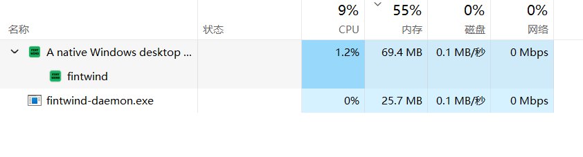

# fintwind

English | [简体中文](README.zh-CN.md)

A native Windows desktop client for [OpenCode 2](https://opencode.ai/v2/docs).
Built with Rust and [GPUI](https://github.com/zed-industries/zed/tree/main/crates/gpui),
not Electron. Manage projects, work in multiple session tabs, and follow the
agent's replies, reasoning, and tool activity in one window.

[Website](https://fintwind.xyz) · [Downloads](https://github.com/roketskiy/fintwind/releases/latest) · [Changelog](CHANGELOG.md)

Session demo: switching models, a session in progress, and scrolling a long transcript.

https://github.com/user-attachments/assets/beb2dcb5-88dd-4f2b-9415-153af9c93bf9

## Install

### 1. Install OpenCode 2

fintwind requires the local `opencode` CLI; it is not bundled with the app.
Choose **one** of these commands in PowerShell:

With [Node.js and npm](https://nodejs.org/):

```powershell
npm install -g @opencode/cli
```

Or with [Bun](https://bun.sh/):

```powershell
bun install -g --trust @opencode/cli
```

The Bun `--trust` flag allows the package's required install script.
These use the V2 package, `@opencode/cli`; see the
[official installation guide](https://opencode.ai/v2/docs/) for other methods.

Open a new PowerShell window and verify the installation:

```powershell
opencode --version
opencode
```

In the OpenCode terminal interface, use `/connect` to connect a model provider,
or use your existing provider configuration. fintwind uses OpenCode's models,
provider credentials, and MCP configuration. You do not need to start
`opencode serve` yourself: fintwind starts its own private local server.

The optional scheduled task MCP requires OpenCode 2.1.4 or newer. Enable it in
**Settings → General → Features**; Fintwind manages the experimental MCP
connection automatically. See [agent-created scheduled tasks](docs/scheduled-tasks-mcp.md).

Optional image generation requires OpenCode 2.2.1 or newer and a compatible
connected image model. Native Goal integration targets OpenCode 2.2.1;
older versions without native Goal cannot use it. See [Goal](docs/goals.md)
and [image model configuration](docs/image-generation.md) for scope.

### 2. Install fintwind

- **System:** Windows 10 version 1809 or newer, or Windows 11; x86_64 or Arm64.
- **Graphics:** a Direct3D 11 driver supporting feature level 11_0 or newer.
- **Git features:** [Git for Windows](https://git-scm.com/download/win), available on `PATH`.

Download `fintwind-<version>-<arch>-Setup.exe` from the
[latest release](https://github.com/roketskiy/fintwind/releases/latest).
The installer runs per-user in `%LOCALAPPDATA%\Programs\fintwind` and does not
require administrator rights.

For the portable version, extract the release `.zip` and run `fintwind.exe`.
**Keep `fintwind.exe` and `fintwind-daemon.exe` in the same folder** — the app
launches the daemon from its own directory.

When a newer release is available, the update card can install it in one
click: fintwind downloads the installer for your architecture, verifies it
against the sha256 published with the release, installs silently without
administrator rights, and restarts into the new version. Portable installs have
no install record, so their update entry still opens the release page. See
[Windows setup and troubleshooting](docs/windows.md) for SmartScreen, CLI
detection, data locations, and WebView2 details.

## Features

- **Image generation.** Enable OpenCode's experimental image tool in General
  settings and choose a default from the current workspace's available image models.
- **Native Goal.** Set a goal with `/goal <goal>`, then inspect, pause, resume,
  or clear it. OpenCode owns goal evaluation and continuation. Old Fintwind goals
  are not migrated automatically.
- **Session Todo.** Follow the agent's task list and completion progress in the
  session capsule, alongside pending added and removed line counts.
- **Keep awake.** Optionally keep the display and system awake while Fintwind runs.
- **Portable OpenCode.** Choose the OpenCode executable in general settings
  without adding a portable installation to PATH. Restore automatic detection
  at any time.
- **Old session cleanup.** Preview and delete sessions inactive for 30, 90, or
  180 days (90 by default). Cleanup covers sessions visible in Fintwind and
  linked to OpenCode, removing the corresponding records from both.
- **Context composition.** A treemap compares eight estimated categories,
  including compaction summaries, tool calls, and tool results. Reported
  occupancy stays separate, and unmeasurable content is marked explicitly.
- **App updates.** Stable builds offer the most recently published full release,
  even when a corrected version number is lower than the installed one. Drafts
  and prereleases are excluded, and the current release is not offered again.
- **Projects and session tabs.** Group sessions by project and open multiple
  sessions in one window, with tab reordering and unread indicators. New sessions
  without a project share a fixed general workspace. Change its folder in
  **Settings → General → Data management**; existing sessions keep their paths.
- **Session controls.** Switch model, reasoning effort where supported, and
  access mode (Ask, Auto-accept edits, Full access). Queue or steer a follow-up
  while the agent works and reorder queued messages by dragging. Choose the
  default send behavior in General settings. Question cards can be skipped,
  collapsed, or expanded. Use OpenCode's
  native revert and restore for eligible Git-backed turns. `/btw` asks a
  one-off side question from the session's settled context without disturbing
  the task in progress.
- **Turn recovery.** Recover missed replies and completion events from OpenCode's
  stored history. History reads accept responses up to 64 MiB and reduce page
  sizes when image or tool payloads make a page too large.
- **Provider marks.** Recognized vendors use their brand marks in the model picker
  and provider settings, with light and dark variants where available.
- **Readable agent activity.** View streaming replies, reasoning, tool calls,
  subagent activity, and nested Code Mode calls with OpenCode's tool names.
  Background shell commands surface as capsules on the session card, and
  finished activity groups fold away on their own. Transcripts and reasoning
  use virtualized lists to limit per-frame work.
- **Files and Git.** Browse workspace files and open multiple file tabs. Review
  staged, unstaged, untracked, and ignored files in a directory tree, load
  directories on demand, and inspect nested repositories and per-file diffs.
  Read Git history as a commit graph. Attach files from the composer or by
  dropping them onto the conversation; images and PDFs are sent inline to OpenCode.
- **Terminal and browser.** Work in a built-in terminal or the optional
  WebView2 browser panel. Enable the browser tools in settings (off by
  default) and the agent can operate browser tabs you share with the session —
  open, observe, click, fill, scroll, navigate, screenshot — within the
  session's access mode. The session interface itself remains native GPUI.
- **Appearance settings.** Choose Fintwind or one of 13 additional theme
  families, select light/dark/system mode, and customize UI and code fonts and
  text sizes. Animations honor the system's reduce-motion preference.
- **Usage statistics.** Explore local OpenCode session history through an
  activity heatmap, daily and hourly charts, and model/provider rankings,
  including subagent usage. Opens with a single day selected, followed by
  7-day, 30-day, and all-time ranges. Displayed costs are estimates, not billing records.
- **Anonymous launch statistics.** Stable and beta builds report a randomly
  generated local installation ID to the project website on each launch to
  count daily active desktops. No sessions, project paths, or account data
  are sent.
- **Provider management.** Sign in and out of built-in providers, see at a
  glance which connections need re-login, and read the provider's own rejection
  reason (quota, key, or model) when a request fails. Custom provider API keys
  use OpenCode credentials; models can inherit the provider protocol or select
  their own, including OpenAI Images and Google Images.
- **Scheduled tasks.** Open the clock icon in the sidebar to run instructions
  on selected weekdays at a set time, or at a fixed interval. Create a session
  with a chosen project, model, and access mode, or reuse an existing session.
  Pause, resume, run immediately, and inspect results. Tasks do not run while
  Fintwind is fully closed, and missed runs are not replayed. Enable **Scheduled
  task MCP** in General settings to let agents create tasks. It is off by
  default and requires OpenCode 2.1.4+. Agents ask for missing task details before
  creating a task. See [the MCP reference](docs/scheduled-tasks-mcp.md).
- **MCP management.** Browse search, office, design, data, automation,
  operations, and business categories. Add remote servers, complete OAuth
  login, and check connection status. Listings use vendor-operated endpoints
  where available.
- **Native Mermaid diagrams.** Read flowcharts, sequence diagrams, class
  diagrams, state diagrams, and more directly in conversations. Switch to
  source or inspect compilation errors. Enable the Mermaid visualization
  prompt in General settings to give new sessions diagram guidance and a
  built-in validation tool. Existing sessions retain their original preference.
- **Native math.** Typeset inline and display formulas, including `\(…\)` and
  `\[…\]`, with layout work performed on background workers.

## Local data and scope

fintwind has no account of its own and does not provide cloud synchronization.
App-managed projects, tasks, and attachments are stored in local SQLite and
files; OpenCode owns its native session data. **Local storage does not mean
offline inference:** prompts and relevant content are sent to the model
providers and tools you configure in OpenCode.

This is an independent [GPL-3.0-only](LICENSE) fork of
[waku](https://github.com/egoist/waku) by [EGOIST](https://github.com/egoist),
not the official OpenCode desktop app. fintwind ships for Windows and uses
OpenCode 2 as its only agent backend. Multiple model providers are available
through OpenCode; other agent backends are outside this fork's scope.

### Memory snapshot

One Task Manager snapshot shows the desktop at 69.4 MB and
`fintwind-daemon.exe` at 25.7 MB — about 95 MB combined. This is not a benchmark
or a total for the full agent stack: it excludes OpenCode and any other
processes, and actual usage varies by workload.



## Architecture

The desktop uses [`fintwind-client`](crates/fintwind-client) to communicate with
a separate [`fintwind-daemon`](crates/fintwind-daemon) process over the
authenticated, versioned WebSocket contract in
[`fintwind-protocol`](crates/fintwind-protocol).
[`fintwind-core`](crates/fintwind-core) implements daemon-owned storage,
workspace and Git operations, and the OpenCode integration. The daemon listens
on loopback and authenticates clients with a token generated at launch.

Release desktop preferences live in `~/.fintwind/app.json`; debug builds use
`temp/app.json`. Daemon provider settings live in `~/.fintwind/settings.json`.
New sessions without a project share `%LOCALAPPDATA%\Fintwind\projects` by
default. You can choose another folder in General settings. Existing sessions
keep their directories, including older dated workspaces under
`~/.fintwind/projects/<date>/<slug>`.

## Development

Requires Windows, the MSVC C++ toolchain and Windows SDK,
[Rust 1.97 or newer](https://www.rust-lang.org/tools/install), and
[Bun](https://bun.sh/). Follow [CONTRIBUTING.md](CONTRIBUTING.md) for setup and checks.

```sh
bun install
bun run dev
```

The development watcher builds the app and a separate
`target/debug/fintwind-debug-daemon.exe`; provider-only changes can replace the
daemon without restarting the debug app. Release builds place
`fintwind-daemon.exe` beside `fintwind.exe`.

See [RELEASING.md](RELEASING.md) for packaging and release maintenance.

## License

[GNU General Public License v3.0 only](LICENSE).
