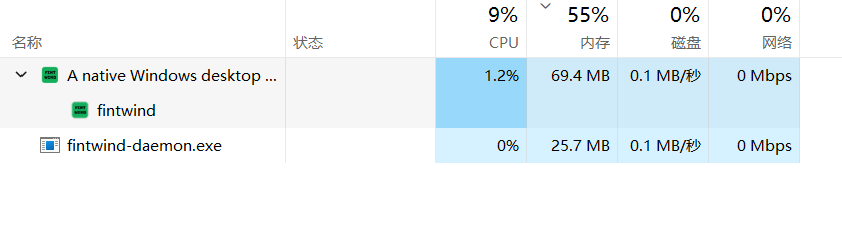

# fintwind

English | [简体中文](README.zh-CN.md)

> [!NOTE]
> **Status — Updates Paused:** [OpenCode](https://opencode.ai/) has released an official Rust client that performs very well in hands-on testing, so updates to fintwind are paused. Existing releases (supporting OpenCode up to 2.4.1) remain available to download and use.

A native Windows desktop client for [OpenCode 2](https://opencode.ai/v2/docs),
built with Rust and [GPUI](https://github.com/zed-industries/zed/tree/main/crates/gpui).
Manage local and SSH remote projects, work across multiple session tabs, and
follow replies, reasoning, and tool activity in one window.

[Downloads](https://github.com/roketskiy/fintwind/releases/latest) · [Changelog](CHANGELOG.md)

Session demo: switching models, a session in progress, and scrolling a long transcript.

https://github.com/user-attachments/assets/beb2dcb5-88dd-4f2b-9415-153af9c93bf9

## Install

### 1. Install OpenCode 2

fintwind requires the local `opencode` CLI (not bundled). Install `@opencode/cli`
in PowerShell with either [Node.js](https://nodejs.org/) or [Bun](https://bun.sh/):

```powershell
npm install -g @opencode/cli
# or
bun install -g --trust @opencode/cli
```

Open a new PowerShell window, verify `opencode --version`, and run `opencode`
to connect a provider with `/connect` (or reuse your existing OpenCode config).
fintwind starts its own private local server, so you do not need `opencode serve`.
After installing fintwind, you can also install OpenCode or update it via
`upgrade` from **Settings → General → Runtime environment**.

This release supports OpenCode up to 2.4.1. Optional feature requirements:

- **Scheduled task MCP:** OpenCode 2.1.4+ (experimental client-hosted MCP, off
  by default in **Settings → General → Features**). See [MCP reference](docs/scheduled-tasks-mcp.md).
- **Image generation:** OpenCode 2.2.1+ and a connected image model.
- **Native Goal:** OpenCode 2.2.1+ ([Goal guide](docs/goals.md)).
- **Background compaction:** OpenCode 2.3.1+.

### 2. Install fintwind

- **Requirements:** Windows 10 (1809+) or Windows 11 (x86_64 or Arm64), a Direct3D 11
  driver (feature level 11_0+), and [Git for Windows](https://git-scm.com/download/win) on `PATH` for Git features.
- **Installer:** Download `fintwind-<version>-<arch>-Setup.exe` from the
  [latest release](https://github.com/roketskiy/fintwind/releases/latest). It installs per-user under `%LOCALAPPDATA%\Programs\fintwind` without administrator rights and supports one-click verified updates.
- **Portable:** Extract the release `.zip` and run `fintwind.exe`. Keep `fintwind.exe` and `fintwind-daemon.exe` in the same folder.

Both packages include the Linux backend for SSH remote connections. See
[Windows setup and troubleshooting](docs/windows.md) for SmartScreen, CLI detection, and data paths.

## Features

- **Projects and session tabs.** Organize sessions by project (existing folder, GitHub clone, or new folder) or share a configurable general workspace. Reorder tabs, track unread state, and clean up inactive sessions.
- **Session controls.** Switch models, reasoning efforts, and access modes (Ask, Auto-accept edits, Full access). Queue or steer follow-ups, complete `/` workspace commands and `@` files/skills, ask `/btw` side questions ([details](docs/btw.md)), use Git-backed revert/restore, and handle forwarded subagent questions and approvals.
- **Prompt privacy.** Enabled by default. Replaces detected credentials and email addresses with reusable references before sending to models, highlights matches in the composer and transcript, and restores originals in display and eligible tool arguments. Rules adapted from [Gitleaks](docs/licenses/gitleaks.txt) and [CredSweeper](docs/licenses/credsweeper.txt).
- **Rich transcripts and previews.** Virtualized lists for streaming replies, reasoning, tool calls, subagents, background processes, and errors. Renders native [Mermaid diagrams](docs/diagrams.md) ([Ondine](docs/licenses/ondine-MIT.txt)), LaTeX math, local/inline images, and copyable links, with a unified fullscreen viewer for zoom, rotation, copy, and PNG export.
- **Files, Git, and terminal.** Browse workspace files in tabs, review directory trees (including nested repos and single-commit changes), read a multi-lane [Git history](docs/git-history.md) graph, commit/pull/push, attach files or drop images/PDFs, and run commands in the built-in terminal.
- **SSH remote workspaces.** Work with Linux (x86_64/ARM64) projects alongside local ones in the same window with automatic backend deployment.
- **Phone remote control.** Connect from a mobile browser via QR code or pairing link over end-to-end encrypted WebRTC direct P2P to switch workspaces, manage sessions, use `@` mentions and `/btw`, monitor background tasks and compaction, and handle approvals. See [remote control](docs/remote-control.md).
- **Usage and subscriptions.** Unified dashboard with clickable token KPIs, period-over-period trend charts, model/provider/project/composition breakdowns, activity matrices/heatmaps, and connected subscription balances (including local Claude Code and Codex). See [provider quotas](docs/provider-quota.md).
- **Models, providers, and MCP.** Offline slimmed `models.dev` catalog, built-in OAuth login and rejection diagnostics, custom provider credentials and image models, and categorized remote/official MCP server management.
- **Goals, Todo, and scheduling.** Track native OpenCode [Goals](docs/goals.md), session Todos with diff counts, and local scheduled tasks (weekly, interval, or one-shot with time zone support) plus optional agent-created tasks via [Scheduled task MCP](docs/scheduled-tasks-mcp.md) (OpenCode 2.1.4+).
- **Reliability and context.** OpenCode native and background compaction, [context composition](docs/context-composition.md) treemap, repeated-output protection, 64 MiB turn recovery, optional keep-awake, and verified in-app updates.
- **Themes and telemetry.** 14 theme families (light, dark, or scheduled auto mode), customizable UI/code fonts, and anonymous daily-active launch ping (random local install ID only).

## SSH remote connections

Connect to a reachable Linux server (x86_64 or ARM64) using a passphrase-less SSH private key (Git on the server is needed for cloning; OpenCode can be installed remotely after connecting).

1. Open **Settings → SSH Connections → New connection**, enter the host details and private key, and choose **Save and connect**.
2. Click **Add project**, pick the server, and open an existing folder, clone from GitHub, or create a new folder.
3. Switch between **This computer** and remote hosts from the sidebar footer.

Connections verify host fingerprints, tunnel everything over SSH without extra open ports, and allow managing server-side OpenCode, providers, MCP, and skills from the settings machine picker. Removing a connection only deletes local connection metadata.

## Local data and scope

fintwind has no account system or cloud sync. App state lives in local SQLite and files; native session history is managed by OpenCode (locally or on the SSH host). Prompts still go to your configured OpenCode providers (with prompt privacy enabled by default).

This is an independent [GPL-3.0-only](LICENSE) fork of [waku](https://github.com/egoist/waku) by [EGOIST](https://github.com/egoist), not the official OpenCode desktop app. fintwind targets Windows and OpenCode 2 only.



*Example Task Manager snapshot (desktop 69.4 MB, daemon 25.7 MB, excluding OpenCode and model processes; not a benchmark).*

## Architecture and development

The desktop client ([`fintwind-client`](crates/fintwind-client)) talks to [`fintwind-daemon`](crates/fintwind-daemon) over a versioned WebSocket protocol ([`fintwind-protocol`](crates/fintwind-protocol)), backed by [`fintwind-core`](crates/fintwind-core) for storage, Git, and OpenCode integration. SSH hosts tunnel the same protocol to a Linux daemon on the server.

Building from source requires Windows, MSVC C++ toolchain with Windows SDK, [Rust 1.100+](https://www.rust-lang.org/tools/install), and [Bun](https://bun.sh/). See [CONTRIBUTING.md](CONTRIBUTING.md) and [RELEASING.md](RELEASING.md) for setup, checks, and packaging.

```sh
bun install
bun run dev
```

## License

[GNU General Public License v3.0 only](LICENSE).
