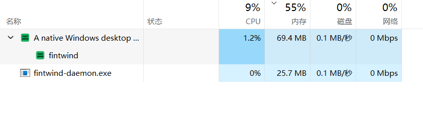

# fintwind

[English](README.md) | 简体中文

[OpenCode 2](https://opencode.ai/v2/docs) 的原生 Windows 桌面客户端。
使用 Rust 和 [GPUI](https://github.com/zed-industries/zed/tree/main/crates/gpui) 构建，
不是 Electron 套壳。在一个窗口内管理本机与 SSH 远端项目、打开多个会话标签页，
并查看 agent 的回复、思考过程和工具活动。

[下载](https://github.com/roketskiy/fintwind/releases/latest) · [更新日志](CHANGELOG.md)

会话演示：切换模型、进行中的会话，以及滚动一条很长的对话记录。

https://github.com/user-attachments/assets/beb2dcb5-88dd-4f2b-9415-153af9c93bf9

## 安装

### 1. 安装 OpenCode 2

fintwind 依赖本机的 `opencode` CLI，应用安装包不包含它。
在 PowerShell 中执行以下命令之一，**两种方式任选一种即可**。

使用 [Node.js 和 npm](https://nodejs.org/)：

```powershell
npm install -g @opencode/cli
```

或使用 [Bun](https://bun.sh/)：

```powershell
bun install -g --trust @opencode/cli
```

Bun 的 `--trust` 用于允许运行这个包必需的安装脚本。
这里使用的是 V2 的包名 `@opencode/cli`；其他安装方式见
[OpenCode 官方安装文档](https://opencode.ai/v2/docs/)。
安装 fintwind 后，也可在「设置 → 通用 → 运行环境」中通过 npm 或 Bun 安装、更新
OpenCode。应用内更新仅适用于当前 npm 或 Bun 管理的安装；便携版等其他安装方式需自行更新。

重新打开一个 PowerShell 窗口，检查安装并启动 OpenCode：

```powershell
opencode --version
opencode
```

在 OpenCode 终端界面中通过 `/connect` 连接模型提供商，
或使用已有的提供商配置。fintwind 使用 OpenCode 的模型、提供商凭据和 MCP 配置。
**无需手动运行 `opencode serve`**：fintwind 会启动自己的本地私有服务。

本版支持到 OpenCode 2.3.2。可选功能的版本要求：

- 浏览器 MCP 与定时任务 MCP：OpenCode 2.1.4+，在「设置 → 通用 → 功能」中开启，
  Fintwind 自动管理实验性 MCP 连接。详见 [Agent 创建定时任务](docs/scheduled-tasks-mcp.md)。
- 图像生成：OpenCode 2.2.1+ 及已连接的兼容图像模型。
- 官方 Goal：适配依据 OpenCode 2.2.1，旧版本没有官方 Goal 时不能使用，见 [Goal 说明](docs/goals.md)。
- 后台压缩：OpenCode 2.3.1+。

### 2. 安装 fintwind

- **系统：** Windows 10 1809 或更新版本，或 Windows 11；x86_64 或 Arm64。
- **图形驱动：** 支持功能级别 11_0 或更高的 Direct3D 11 驱动。
- **Git 功能：** 安装 [Git for Windows](https://git-scm.com/download/win)，并确保 `PATH` 中可用。

从[最新 release](https://github.com/roketskiy/fintwind/releases/latest) 下载
`fintwind-<version>-<arch>-Setup.exe` 并运行。安装程序按用户安装到
`%LOCALAPPDATA%\Programs\fintwind`，不需要管理员权限。

使用便携版时，解压 release 中的 `.zip`，运行 `fintwind.exe`。
**`fintwind.exe` 和 `fintwind-daemon.exe` 必须放在同一目录**，应用会从自身目录启动 daemon。
正式 release 安装包还包含 [SSH 远端连接](#ssh-远端连接)所需的后端，无需单独下载。

有新版本时，更新卡片可以一键升级：自动下载与当前架构匹配的安装包，按 Release
公布的 sha256 校验后静默安装，不需要管理员权限，装完自动重启应用。解压即用的
便携版没有安装记录，更新入口仍会打开对应的 release 页面。
SmartScreen、CLI 检测、数据目录和 WebView2 说明见
[Windows 安装与故障排查](docs/windows.md)。

## 功能

- **SSH 远端工作区。** 连接 Linux 服务器，像本机一样使用服务器上的项目和会话，
  与本机任务在同一窗口并行；后端自动安装，侧边栏底部切换主机。
  详见 [SSH 远端连接](#ssh-远端连接)。
- **手机远程控制。** 从桌面侧边栏开启后，扫码或打开配对链接，即可在手机网页切换工作区、查看和新建会话、发送消息和附件、停止任务、处理权限审批与回答问题。连接使用端到端加密，无需账号；桌面须保持运行，仅开放启用时已登记的工作区及最近 72 小时内更新的会话。关闭远控、退出桌面或重新配对后，旧配对失效。详见 [手机远控说明](docs/remote-control.md)。
- **项目与会话标签页。** 按项目管理会话，在同一窗口打开多个会话，支持标签拖动排序和未读提示。
  「添加项目」对话框支持现有文件夹、GitHub 克隆与新建文件夹三种方式，项目名称可选，默认使用文件夹名。
  未关联项目的新会话共用固定通用工作区，可在「设置 → 通用 → 数据管理」中更改文件夹；已有会话保留原目录。
- **会话控制。** 切换模型、模型支持的思考程度，以及访问模式（询问、自动接受编辑、完全访问）。
  agent 工作时可以排队或插话，排队的消息收进输入框卡片内部，可折叠，默认展开，支持拖拽排序；
  通用设置可选择默认发送方式，提问卡片支持跳过、收起与展开。符合条件的 Git 回合可通过 OpenCode
  原生功能回退和恢复。`/btw` 基于会话中已定稿的上下文提一个一次性的旁问，不打断进行中的任务。
- **回合恢复。** 从 OpenCode 持久化历史补齐错过的回复与结束状态；历史响应支持最多 64 MiB，
  图片或工具结果导致单页过大时自动缩页读取。中断后不再误显示“工作中”，失效的运行在下次提交时重建。
- **上下文压缩。** 由 OpenCode 原生自动与后台压缩执行：输入窗口占用达到阈值时自动压缩，
  后台压缩在接近阈值前提前生成摘要（需要 OpenCode 2.3.1+）。阈值按百分比设置，
  工作区或自定义 OpenCode 配置优先，两者默认开启。
- **重复输出保护。** 模型回复或工具调用及结果连续 10 次完全相同时自动停止任务，
  默认开启，可在通用设置关闭。
- **清晰的 agent 活动。** 查看流式回复、思考、工具调用、子代理活动和嵌套 Code Mode 调用，
  保留 OpenCode 的工具名称。后台工作面板列出后台进程与子智能体，显示子代理引导消息与运行时长，
  未运行的子智能体默认折叠。会话错误以持久化活动卡片呈现，活动组显示本组耗时与步数。
  对话记录和思考过程使用虚拟化列表，限制每帧需要处理的内容。
- **文件与 Git。** 浏览工作区文件并打开多个文件标签页。审阅页按目录树分别展示已暂存、未暂存、未跟踪和已忽略文件，按需加载目录，并支持查看嵌套仓库和单文件差异。Git 历史使用固定列位的多分支泳道图，展示分支与标签；卡片式提交框支持 Ctrl+Enter，通过一体式按钮执行提交、拉取、推送及更多操作；分支切换失败保留现场并支持重试。
  可从输入栏添加附件，也可将文件拖到对话中；图片和 PDF 会内联发送给 OpenCode。
- **终端与浏览器。** 提供内置终端和可选的 WebView2 浏览器面板。在设置中开启浏览器工具
  （默认关闭，需要 OpenCode 2.1.4+）后，所有会话中的 agent 均可操作已打开的标签页，包括手动打开的页面，无需逐页授权，也不按会话隔离。
  支持打开、观察、点击、填写、滚动、导航和截图，也支持本机文件页面及密码框操作；快照可包含密码与隐藏表单值。会话界面本身仍由原生 GPUI 渲染。
- **用量与订阅。** 用量页提供总览指标、用量流向图（模型份额汇入缓存读取、输入、输出、缓存写入与推理的全量构成，点击高亮对应流向）、订阅额度轮播、趋势图、模型/提供商/项目排行与活动热力图，并计入子代理用量。单日统计提供按小时图表并可逐日切换；时间范围默认 7 天，另有单日、30 天与全部。额度页集中展示已连接且受支持的供应商，包括本机 Claude Code 与 Codex 订阅。数据来源与范围见 [供应商额度说明](docs/provider-quota.md)。
- **模型目录。** 内置 models.dev 精简模型表：仅保留知名 AI 实验室官方条目与两年内发布的模型，
  含名称、上下文、输入输出模态与思考档位，运行时离线读取，不再联网拉取。
  自定义模型可多选思考程度（none/low/medium/high/xhigh/max），留空跟随目录档位或标准六档。
- **提供商管理。** 内置提供商可以登录和退出，一眼可见哪些连接需要重新登录；
  请求被拒时能看到提供商自己的拒绝原因（额度、密钥或模型）。自定义提供商的 API 密钥由 OpenCode 凭据托管，模型可继承提供商协议或单独指定协议，包括 OpenAI Images 和 Google Images。
- **图像生成。** OpenCode 的实验性图像工具随版本与已连接图像模型可用（需要 OpenCode 2.2.1+）；
  通用设置选择默认图像模型，「自动」由 OpenCode 按请求选择可用模型。
- **官方 Goal。** 通过 `/goal <目标>` 设置目标，支持查看、暂停、恢复和清除；目标评估与续跑由 OpenCode 管理，旧版 Fintwind 目标不会自动迁移。
- **会话 Todo。** 在会话胶囊中查看 Agent 的任务列表与完成进度，同时查看待处理的增删行数。
- **保持唤醒。** 可选在 Fintwind 运行期间保持屏幕和系统唤醒。
- **OpenCode 运行环境。** 在通用设置中检查版本，并安装或更新由 npm、Bun 管理的 OpenCode；也可选择便携版可执行文件，无需将其加入 PATH，支持恢复自动检测。
- **旧会话清理。** 按最后活动时间预览并清理超过 30、90 或 180 天的会话，默认 90 天；
  仅清理 Fintwind 中可见且关联 OpenCode 的会话，同时删除双方的对应记录。
- **[上下文构成](docs/context-composition.md)。** 面积分块图展示八类上下文的估算占比，将压缩摘要、工具调用和结果分别统计；
  实际占用与估算分开显示，不可测内容明确标记。
- **应用内更新。** 正式版按发布时间选择最新正式 Release，即使修正后的版本号更小也会提示更新。
  排除草稿与预发布，当前已是最新发布时不重复提示。
- **定时任务。** 从侧边栏时钟图标进入，按指定星期与时间、固定间隔，或按具体日期时间执行一次。
  日期改用日历选择，单次任务运行后自动停用并保留历史。创建时记录 IANA 时区并按该时区执行。
  可新建会话并选择项目、模型与权限，也可复用已有会话；支持暂停、恢复、立即运行和查看运行结果。
  Fintwind 完全退出后任务不会执行，错过的运行不会补跑。
  通用设置可开启「定时任务 MCP」，允许 Agent 创建任务，默认关闭，需要 OpenCode 2.1.4+；
  未明确的任务信息由 Agent 向用户询问。详见 [MCP 说明](docs/scheduled-tasks-mcp.md)。
- **MCP 管理。** 浏览搜索、办公、设计、数据、自动化、运维与商务等分类，
  添加远程服务器、完成 OAuth 登录并查看连接状态；有厂商官方端点的条目优先使用官方服务。
  远端主机的 MCP 登录在本机浏览器完成。
- **原生 Mermaid 图表。** 在对话中直接查看流程图、时序图、类图、状态图等图表，
  点击图表（或聚焦后按 Enter/Space）进入全屏预览，支持放大、缩小、重置 1:1，按 Esc 关闭；
  配色跟随主题，多系列为彩色并区分深浅主题。
  支持切换源码，编译失败时显示原因。可在通用设置中为新会话开启「Mermaid 可视化提示词」，
  让模型使用内置校验工具检查图表；已有会话保留创建时的偏好。
- **原生公式排版。** 支持行内和独立公式，包括 `\(…\)` 和 `\[…\]`，排版工作在后台执行。
  行内 1.21 倍、独立 1.25 倍显示，超宽公式独占一行并在原位横向滚动，不打乱正文排版。
- **外观设置。** 保留 Fintwind 主题，并提供另外 13 套主题家族；支持浅色、深色和自动模式，
  以及界面和代码字体、字号设置。自动模式按本地时间在 7:00 起使用浅色、19:00 起使用深色，不跟随系统外观；动效遵循系统的「减弱动态效果」偏好。
- **匿名启动统计。** 正式版和 beta 每次启动向项目官网上报一个本地随机生成的安装 ID，
  用于统计每日活跃的桌面数量；不包含会话、项目路径或账号信息。

## SSH 远端连接

连接 Linux 服务器，直接在 Fintwind 里使用服务器上的项目和会话，与本机任务在同一窗口并行。
Fintwind 会在服务器上自动安装和更新所需的后端，无需手动配置。

### 需要准备

- 一台能从本机 SSH 登录的 Linux 服务器（x86_64 或 ARM64）。
- 登录用的私钥文件，**未设置密码短语**；不支持密码登录。
- 服务器上装有 OpenCode；没有的话，连接后可在 Fintwind 里安装。克隆项目需要服务器装有 Git。

### 开始使用

1. 打开「设置 → SSH 连接 → 新建连接」，填写名称、主机、端口、用户名，选择私钥文件，
   点击「保存并连接」。
2. 在会话区点击「添加项目」，选择这台服务器，三种方式任选：
   - **现有文件夹**：填写项目在服务器上的路径。
   - **GitHub 克隆**：填写仓库地址，克隆在服务器上进行并显示进度；私有仓库需服务器已有访问权限。
   - **新建文件夹**：创建一个空项目。

   已存在的目录不会被覆盖；添加失败时输入保留，可以重试。
3. 添加后即可像本机项目一样使用。侧边栏底部在「本机」与各服务器之间切换；
   断线重连或桌面升级后，远端会话自动恢复。

### 注意事项

- 首次连接会记住服务器指纹，之后指纹变化时连接会被阻止。
- 所有通信都走 SSH 加密连接，服务器无需开放额外端口。
- 提供商、MCP、技能与通用设置可在设置侧栏底部切换到服务器，修改作用于服务器，
  也可检查、安装、更新服务器上的 OpenCode。断线时服务器设置只读；
  外观与 SSH 连接设置始终属于本机。
- 服务器上有任务运行时，后端更新会等任务结束再进行。
- 「移除连接」只删除本机保存的连接信息，服务器上的项目不受影响。

## 本地数据与项目范围

fintwind 没有自己的账号，也不提供云端同步。应用管理的项目、任务和附件存储在本机的
SQLite 与文件中，OpenCode 原生会话数据由 OpenCode 管理；SSH 远端的会话数据由服务器上的
OpenCode 管理。
**本地存储不等于离线推理：** 提示词及相关内容仍会发送给你在 OpenCode 中配置的模型提供商和工具。

本项目是 [EGOIST](https://github.com/egoist) 的 [waku](https://github.com/egoist/waku)
的独立 fork，采用 [GPL-3.0-only](LICENSE)，不是 OpenCode 官方桌面端。
fintwind 只发布 Windows 版本，只使用 OpenCode 2 作为 agent 后端。
你仍然可以通过 OpenCode 使用多个模型提供商；其他 agent 后端不在本 fork 的范围内。

### 内存快照

一次任务管理器截图中，桌面进程占用 69.4 MB，`fintwind-daemon.exe` 占用 25.7 MB，
两者合计约 95 MB。这不是性能基准，也不是完整 agent 运行环境的总内存：
不包含 OpenCode 和其他进程，实际占用会随工作负载变化。



## 架构

桌面端通过 [`fintwind-client`](crates/fintwind-client) 与独立的
[`fintwind-daemon`](crates/fintwind-daemon) 进程通信，使用
[`fintwind-protocol`](crates/fintwind-protocol) 定义的带鉴权、带版本的 WebSocket 协议。
[`fintwind-core`](crates/fintwind-core) 实现 daemon 管理的存储、工作区与 Git 操作，
以及 OpenCode 集成。本机 daemon 监听回环地址，并使用每次启动时生成的令牌鉴权。
连接 SSH 主机时，桌面通过 SSH 隧道与部署在服务器上的 Linux daemon 使用同一协议通信，
隧道断开后自动重连。

Release 桌面端配置位于 `~/.fintwind/app.json`，Debug 使用 `temp/app.json`。
daemon 的提供商设置位于 `~/.fintwind/settings.json`。
SSH 连接配置位于 `%LOCALAPPDATA%\Fintwind\ssh-profiles.json`。
未关联项目的新会话默认共用 `%LOCALAPPDATA%\Fintwind\projects`，可在通用设置中选择其他文件夹。
已有会话保留原目录，包括旧版位于 `~/.fintwind/projects/<日期>/<slug>` 的工作区。

## 开发

需要 Windows、MSVC C++ 工具链与 Windows SDK、
[Rust 1.97 或更新版本](https://www.rust-lang.org/tools/install)，以及 [Bun](https://bun.sh/)。
环境配置与检查要求见 [CONTRIBUTING.md](CONTRIBUTING.md)。

```sh
bun install
bun run dev
```

开发 watcher 会构建桌面端和独立的 `target/debug/fintwind-debug-daemon.exe`；
只修改 provider 相关代码时，可以替换 daemon 而不重启 Debug 桌面端。
Release 构建会把 `fintwind-daemon.exe` 放在 `fintwind.exe` 旁边。

打包和发布维护流程见 [RELEASING.md](RELEASING.md)。

## 许可证

[GNU General Public License v3.0 only](LICENSE)。