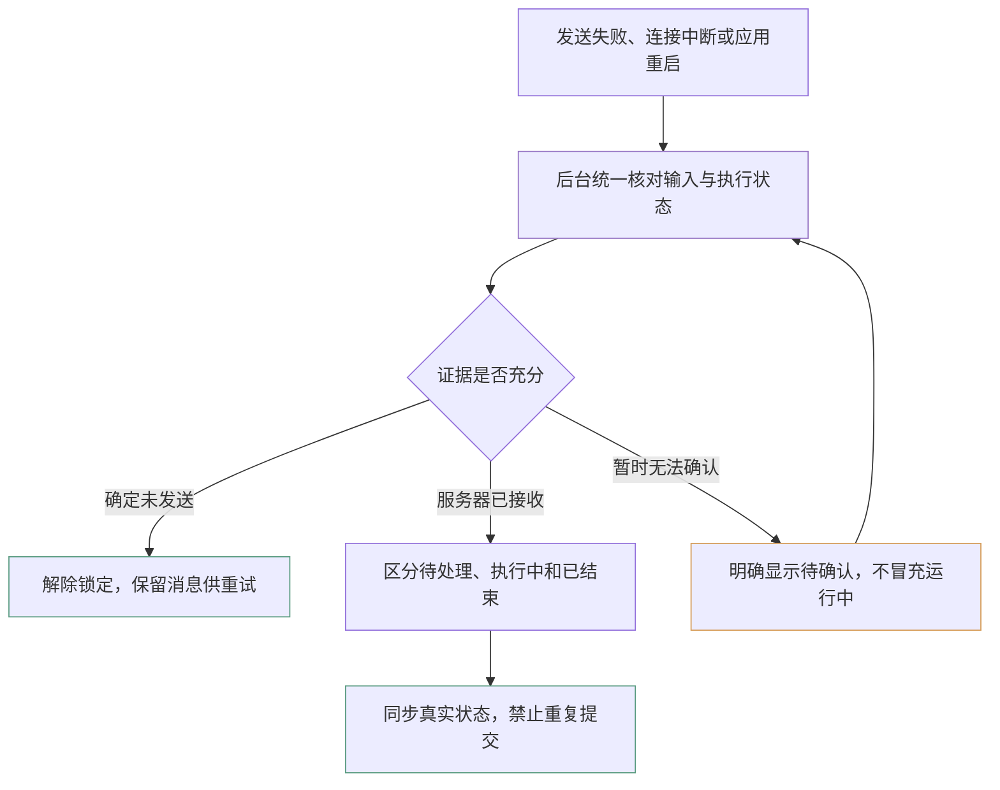

# 会话中断、发送不确定与重启恢复：完整修复方案

日期：2026-10-30。状态：待实施，本文不代表功能已经实现或验收通过。

## 1. 目标与范围

解决以下完整故障链，而不是只清除界面的运行标记：

> OpenCode 私有服务连接失效 → 用户发送“继续”仍使用旧连接 → 发送结果变为
> unknown → 停止仅结束本地轮次 → unknown 持续阻止发送 → 重启后重新锁定。

交付目标：

1. 死亡运行实例不能被重新附着或接受新提交。
2. 区分确定未发送、服务器已接收和发送结果待确认。
3. 断线、停止、退出和重启后均有明确的恢复责任方。
4. 安全修复已经落盘的异常记录，保留原会话、历史、附件和工作区改动。
5. 不丢消息、不盲目重发、不虚报运行或停止；不能因异常记录无限锁住整个界面。

保留 GUI / daemon / 私有 OpenCode 服务分层和共享原生会话数据库。生产恢复只
通过受支持的 API 核对 OpenCode，不直接修改其数据库，不重启或接管公共服务，
不自动续跑模型，不建立客户端无法保证的跨进程执行锁。

### 与既有文档的关系

- [submission-reliability.md](submission-reliability.md)：第一批提交可靠性的现状与边界。
- [opencode-recovery.md](opencode-recovery.md)：事件恢复、原生完成证据和分页预算。
- [performance.md](performance.md)：后台工作和流式帧处理约束。

本方案扩展第一批明确暂缓的执行投影、停止和异常发送恢复，不废弃稳定输入 ID、
持久化认领、原生终态证明和禁止盲目重发。既有“未知继续按忙碌处理”及“仅保留
处理中呈现”的限制，将在实施本方案时由明确的待确认状态替代；不为正常发送
增加保存、接收等过程标签。实施完成后再更新现状文档，不能提前宣称已支持。

## 2. 已确认事实与调查边界

2026-10-30 的本地日志和数据库备份确认：

- 原私有服务端口 23632 先出现 read_error，随后 connect_failed。
- 后续“继续”仍提交到该旧端口，错误为连接建立失败，发送记录保存为 unknown。
- 用户停止后，最新本地轮次为 interrupted，但发送记录仍为 unknown，会话仍为 working。
- 该输入 ID 在 OpenCode 消息历史和 inbox 中均不存在；原生会话之后已有 interrupted 终态。
- 重启会重新加载持久化 unknown，因此仅重启界面或 daemon 不能修复。

最初私有服务为何退出仍未确认。退出前有监视器更新不能证明因果；无 Windows
崩溃事件也不能排除异常退出。连接恢复与状态修复不依赖先解决这一触发原因。

上述查询结果是现场证据，不等于可将所有“历史缺失”一律判断为未发送。
私人数据库、提示词和原始载荷不得提交进仓库或作为公开测试资源。

### 当前代码落点

| 问题 | 当前入口 |
| --- | --- |
| AttachSession 只检查句柄存在，未检查可用性 | `crates/fintwind-core/src/daemon.rs`：AttachSession、Start 事件转发 |
| submit 只检查命令通道；工作线程仍持有旧 server | `crates/fintwind-core/src/driver/opencode.rs`：submit、Prompt |
| 连接失败与确认丢失统一进入 Unknown | 同文件 Prompt 错误分支；`crates/fintwind-core/src/opencode_session.rs`：HTTP 请求 |
| 找不到精确输入时没有未发送恢复出口 | `crates/fintwind-core/src/driver/opencode/recovery.rs`：fetch_turn；daemon 的 fetch_native_transcript |
| unknown 不受轮次 interrupted 影响，继续阻止发送 | `crates/fintwind-protocol/src/submission.rs`：has_unsettled_submissions |
| Stop 只在有活动轮次时恢复 Idle | `src/app/sessions.rs`：cancel_turn |
| 投影、冷历史和队列分别处理忙碌状态 | `src/app/streaming.rs`、`runtime.rs`、`native_sessions.rs` |

## 3. 实现前的失败清单

| 编号 | 失败方式 | 必须保持的行为 |
| --- | --- | --- |
| F01 | 保存本地输入失败 | 不做 provider POST；草稿或可恢复输入保留 |
| F02 | 准备期间退出或停止 | 未发送内容不丢失；旧准备任务不得随后提交 |
| F03 | 服务在连接前退出 | 有未写出证明时结算为未发送，不虚报执行 |
| F04 | 检查存活后、实际发送前退出 | 以实际传输结果处理，不依赖预检查结论 |
| F05 | 写请求途中退出或丢失响应 | 保留输入 ID 和不确定事实，不自动重发 |
| F06 | 服务已接收，但本地回执保存失败 | 重启可核对，不重新 POST |
| F07 | 输入仅存在于 inbox | 认定已接收但待处理，不能认定缺失或完成 |
| F08 | 原生 ID 冲突或不明确 HTTP 错误 | 按结构化错误和协议核对，不能靠字符串猜测 |
| F09 | SSE 断开而进程仍活着 | 重连与对账，不能误报进程死亡 |
| F10 | 进程真实退出，但 daemon 留有句柄 | 旧实例不可附着、不可提交；恢复不随订阅终止 |
| F11 | 漏掉执行终态、历史多页或响应超限 | 沿用完整窗口及预算；不以部分历史结算 |
| F12 | Stop 排在阻塞提交之后 | 停止意图及时持久化，不能静默等待长超时 |
| F13 | Stop 后已有队列或停止期间重启 | 不自动出队；恢复后优先处理停止意图 |
| F14 | 轮次已结束但 unknown 残留 | 仍能核对和处理，不依赖 active_turn 存在 |
| F15 | 旧事件、旧 attach、旧快照迟到 | 不覆盖新实例、已结算记录或修复结果 |
| F16 | 其他客户端操作同一原生会话 | 不把本私有进程的 active 缺席当全局停止证明 |
| F17 | 一次历史或 inbox 查询缺失、失败或分页未完成 | 不据此断言未送达；待确认不是运行中 |
| F18 | 多个会话共用服务，部分恢复失败 | 不重复启动服务，不拖垮其他会话，不全库逐帧扫描 |

## 4. 状态与权威归属

### 4.1 三个独立维度

下表是目标语义，最终 Rust 类型名按实现评审确定，不要求机械增加所有枚举值。

| 维度 | 语义 | 权威 |
| --- | --- | --- |
| 连接 | 正在连接、可用、重连中、失效 | daemon 管理的进程与传输状态 |
| 提交接收 | 准备中、提交中、未发送、已接收、待确认、明确拒绝 | 持久化提交和尝试记录，结合 provider 接收证据 |
| 执行 | 待处理、执行中、已完成、已中断、失败、尚不可知 | 原生执行、inbox 和持久化终态证据 |

`Unknown` 只表示尚不能确认接收结果。`Accepted` 不表示已经执行。
本地 `Interrupted` 不能证明服务器停止。`ProcessExited` 只描述一个已确认的
运行实例退出，不替代全局会话终态。最后一次已知状态不等于当前状态。

会话忙碌标记改为派生投影。拆开“允许编辑”“允许提交”“允许出队”“停止
是否可用”的判断，不再以一个 `has_unsettled_submissions` 布尔值同时决定它们。
不确定期间可以阻止真正的后续 POST，但必须明确原因并保留草稿、历史与核对操作。

### 4.2 daemon 是唯一状态变更入口

- GUI 提交用户意图并显示投影，不直接宣告 provider 接收或执行终态。
- daemon 负责提交认领、停止意图、对账和恢复写回；不依赖选中某个标签页。
- 事件更新携带实例身份及投影 revision；GUI 和 daemon 均拒绝过期结果。
- SaveTaskState 只能合并允许由 GUI 修改的内容，不得覆盖 daemon 持有的提交、
  停止意图和执行事实。新字段遗漏或旧客户端快照不能把新事实擦除。
- 接收确认、取消和修复均用事务及比较更新；状态不以墙上时钟先后单独仲裁。

## 5. 发送尝试与连接生命周期

### 5.1 持久化发送证据

在现有提交记录之外保留可审计的尝试元数据，至少包括：

- submission ID、固定 input ID、attempt ID、native session ID；
- daemon epoch、runtime generation、私有 server instance ID；端口仅供定位，不能作为实例身份；
- 尝试阶段、结构化结果、记录 revision、已知未写出证明；
- 未解决的先前尝试是否存在，以及当前停止意图。

具体以附加表或版本化 JSON 落地，须沿用现有迁移工具。单独保存 attempt，避免
后一次失败覆盖前一次仍可能已经送达的尝试。不同 POST 的身份不能只用时间区分。

在首次可能写请求前，先持久化“可能开始发送”的围栏；保存失败禁止写出。
崩溃发生在围栏提交与首次写出之间时，保守恢复为待确认，不伪造未发送证明。
连接失败或本地准备失败可产生明确未写出结果，但仅在不存在其他未解决尝试时
才能据此把整个提交结算为未发送。

同一提交的 DispatchSubmission 仍只允许一次原子认领。确认丢失、RPC 重试、
重启和手动重新核对都不是重新 POST 的授权。安全的用户重试在原提交明确结算
后建立新的提交身份，不能重置旧记录再发送。

### 5.2 结构化传输结果

| 结果 | 处理 |
| --- | --- |
| 序列化或连接建立失败，确定未写出 | NotSent，并同步结束该次本地提交 |
| 已可能写出，请求/响应中途失败 | Unknown，安排对账，不重发 |
| 收到有效接收证据 | Accepted，继续核对 inbox 与执行 |
| 明确拒绝 | Rejected；保留原因代码和原输入 |
| HTTP 409、响应格式变化或不明确错误 | 按版本协议核对，不一概视为拒绝 |

HTTP 层保留阶段、状态码及类型化错误，不再搜索 `HTTP 4` 等错误文本。
有效 2xx 与响应解析失败分开处理；是否已持久接收依据该版本接口约定，不因
JSON 解析失败抹掉已有接收事实，也不把任意 2xx 当作完整执行结束。

### 5.3 失效实例回收

- 显式区分 SSE 故障、HTTP 不可达和自有子进程退出。
- 实例确认死亡后，先使其不可附着、不可提交，再发布退出事实；按 generation
  条件移除 map 中对应句柄。迟到退出事件不能移除新实例。
- 命令通道可写不是运行可用证明。AttachSession 与 DispatchSubmission 均需
  验证当前实例状态；验证与失效标记有一致的并发边界。
- 回收事件订阅、权限轮询和实例级工作，但提交恢复责任移交给 daemon 对账器。
- 下一次合法显式提交可获取有效私有服务，保留原生 session ID；不隐式续跑旧提交。
- 复用现有服务池，不能因每个坏会话分别重启服务，也不能为自愈终止健康服务。

## 6. 统一后台对账

对账器由 daemon 持有，触发于未知接收、订阅重建、实例退出、启动扫描和显式
核对。live 恢复、冷历史读取与启动恢复复用同一证据判定及状态提交逻辑，不能
各自推导出矛盾的 Working / Idle。

### 6.1 核对步骤

1. 捕获提交 revision、固定输入 ID、相关实例和停止意图。
2. 读取原生会话、inbox、必要历史窗口及执行证据，检查分页完整性。
3. 按精确输入身份匹配，不能只比较“继续”等文字或取最后一条用户消息。
4. 判定接收事实与执行事实；需要结束时，沿用完整原生窗口和 idle 顺序证明。
5. 写回前验证 revision / generation；过期结果丢弃或重排，不覆盖较新事实。
6. 原子保存提交、轮次及会话投影，再发布新 revision 给客户端。

| 证据 | 结论 |
| --- | --- |
| 精确 ID 存在于 inbox | 已接收、待处理；不能解除为未发送或按旧 idle 结算 |
| 精确 ID 已进入历史，但缺少本轮结束证明 | 已接收；执行状态继续核对 |
| 本轮输入及其后的完整原生终态已验证 | 同步真实结束状态与完整内容 |
| 确定无请求写出，且无先前不确定尝试 | 未发送，可结束本次提交 |
| 历史缺失、查询失败、预算不足或仍有可能在途的请求 | 仍待确认，不显示持续运行 |

### 6.2 未送达的证明边界

单次历史缺失、inbox 缺失、active 缺席、超时或私有进程退出，均不能单独证明
某个先前请求未被接收；多次相同的非原子查询也不能自动升级为证明。

除结构化未写出结果外，若要依靠事后缺失结算，必须证明旧尝试已无法继续生效，
并从同一原生存储取得覆盖所需范围的一致证据。实现前核实当前 OpenCode API
是否提供该能力、输入 ID 去重及取消约定；不能由“接受客户端 ID”推导出安全重试。

若受支持 API 不足以排除在途接收，不新增“超时自动判失败”捷径。保留待确认，
允许编辑、复制和重查，明确后续提交尚受保护。若要承诺所有不确定输入都能在
有限时间内安全重发，需要上游的可查询、幂等接收协议，不能只靠客户端实现。

### 6.3 调度和性能

- 启动按可检索的未解决提交分页扫描，不为每帧、每行或每个标签全量加载历史。
- 每个原生会话至多一个对账查询在途；进程级设置有界并发和公平调度。
- 失败指数退避并加入抖动，用户核对可提前唤醒，但必须合并重复请求。
- 沿用既有 3 秒请求、12 秒分页预算及历史容量限制；新增查询也有总预算。
  预算耗尽只表示本轮核对失败，不表示执行失败。
- 正常长推理/长工具不因无输出超时；沿用流提交和 pulse clock 节奏。
- 所有网络、存储、进程检查和历史翻译在后台。render 仅读内存投影，完成后
  定向通知，不因对账引入持续动画或全窗口刷新。

## 7. 停止意图、队列与界面

### 7.1 停止是持久化控制操作

停止意图独立于接收回执和本地轮次存在，绑定会话、提交边界和 revision。
重复停止幂等；服务器恢复后不得把旧停止意图应用到用户后续明确开始的新轮次。

| 当前事实 | 停止处理 |
| --- | --- |
| 准备中或确定未发送 | 撤销后续提交权限，完成取消；不丢原输入 |
| 已在 inbox | 按版本支持的取消 API 处理并核对；与进入执行的竞争由后续核对解决 |
| 正在执行 | 发送 interrupt 并核对，不只改 GUI 状态 |
| 断开、接收或执行待确认 | 保存停止意图，显示尚未确认，恢复后优先处理 |
| 已结束但会话投影仍忙碌 | 纠正投影，不要求 active_turn 存在 |

控制操作不排在长时间阻塞的 Prompt 后。实现可采用独立控制通道或有界可取消
的请求机制，但取消本地 socket 不代表服务器操作已撤销。准备任务无法安全
中断时，先撤销发送授权，在安全边界停止，不能强杀共享进程。

Stop 同时持久化队列暂停，取消本轮自动出队安排。已排队内容保留，不自动删除；
在用户明确恢复队列或再次发送前，即使重启、重连或迟到 TurnFinished，也不能
自动发送。停止意图、队列暂停及相关投影在同一事务中保存。

### 7.2 异常界面规则

- 正常回合沿用现有简洁呈现，不给每条消息新增过程说明。
- 只有确实执行中才显示执行动画；断开或待确认使用简洁状态，不冒充持续运行。
- “已停止”需要服务器停止证据，或确定本地尚未发送并已取消的证据。
- 待确认提供“重新核对”和保留输入的操作；禁止没有可见原因的静默拒绝。
- 草稿可编辑、保存和复制。daemon 不可用时不得清空编辑内容或谎报保存成功，
  使用现有草稿机制；必要的本地保护不得绕过 daemon 修改生产任务数据库。
- 无法确认时不提供默认的危险重发；本方案不增加忽略证据的强制继续入口。
- 复用现有控件、翻译和焦点机制；新增交互支持键盘，遵循减弱动态效果设置。

## 8. 已有异常记录与重启恢复

必须处理全部未解决提交，而不是只看最后一轮是否 Running。特别包含
`Interrupted + Unknown`、`Failed + Dispatching` 和会话 Working 但无活动轮次。

启动分两步：先做向后可读的结构迁移，再在后台做证据驱动的数据恢复；不能
在 SQL 迁移中一律把 Unknown 改为 NotSent。

恢复流程：

1. 保留数据库备份和迁移版本；读取全部相关提交及停止意图。
2. 淘汰旧 epoch 的运行可用性声明，但保留旧接收事实；无句柄不等于未执行。
3. 通过统一对账器核对。已有 Accepted 不能被降为 NotSent；历史缺失输入保留。
4. 证据充分后，在事务中更新发送结果、轮次、停止意图和会话投影；记录修复依据。
5. 发布新 revision。重复启动、重复对账和旧快照保存不能恢复原错误状态。

对本次会话，目标是证明“继续”未发送后恢复可操作状态，保留原消息供用户重试，
不删除会话、不换原生 session ID、不回退文件、不自动补发。旧版未记录传输阶段，
因此必须使用可验证的既有证据；若 API 无法提供足够证据，保留待确认并明确报告，
不能为完成迁移而捏造接收结论或仅据错误文案批量修正。

## 9. 协议、迁移与诊断

- 如新增控制命令、投影或枚举，提升当前协议版本并明确能力；GUI 与 daemon
  成对升级。版本不匹配明确拒绝连接，不让旧端按旧 Working 语义覆盖新记录。
- 数据迁移只追加。缺失的尝试阶段默认未知，不能默认未发送；旧状态保留可审计映射。
- 发布前验证受影响状态对旧版本的可读性。数据若无法安全降级，必须明确版本
  限制；回退只能使用匹配的备份，不能删除新记录或覆盖用户之后的消息。
- 日志记录固定原因代码、实例身份、attempt/input ID、revision、超时、恢复决策
  及子进程退出码。不记录提示词、附件、认证头、完整 URL 或原始 provider 错误。
- 诊断日志有总容量上限并轮转保留近期故障，不能达到上限后永远失去新证据。
- stderr 默认只提取允许的诊断信号，不将未知原始内容直接写盘。需要完整载荷
  诊断时另行取得授权并明确隐私风险；不得因“便于排查”默认保存秘密。

## 10. 实施批次与完成条件

以下均为待办，不是已完成项目。先固定失败场景与黑盒断言，再实现对应逻辑。

| 批次 | 工作 | 主要文件/模块 | 完成条件 |
| --- | --- | --- | --- |
| A：契约核实 | 核实实际 OpenCode 版本的 inbox、interrupt、ID 冲突/去重及证据一致性；确定旧数据可恢复边界 | V2 官方协议与隔离真实 OpenCode | 保存脱敏 API 样本及限制，不以旧文档推测 |
| B：阻止再次损坏 | 类型化传输结果、持久化尝试、失效实例回收与 attach/dispatch 校验 | core 的 opencode_session、opencode_pool、driver/opencode；protocol 的 submission；persistence、daemon | F03—F10 通过；失败不再送入失效实例 |
| C：统一恢复和旧数据 | daemon 对账器、原子状态投影、启动扫描和旧快照屏障 | daemon、driver/opencode/recovery、protocol/model/submission、persistence、客户端协议 | F06—F11、F14—F18 通过；旧坏记录不再错误恢复为运行中 |
| D：停止和交互 | 停止意图、控制通道、队列暂停、异常状态和可编辑草稿 | client/driver、src/driver、app 的 runtime/sessions/streaming/native_sessions/composer | F02、F12—F15 通过；停止不静默无效、不自动出队 |
| E：完整验收与发布 | 黑盒矩阵、重启验证、协议配对和诊断检查，更新现状文档 | 现有 recovery/protocol E2E 与必要的新整体场景 | 验收产物完整；明确真实 provider 和桌面验证边界 |

B 不能作为整项修复完成：它不会自动解除旧 Unknown。C 也不能跳过 D：仅恢复
数据库不足以保证用户停止、编辑和再次发送正常。证据无法闭合的旧记录必须列出
剩余限制，不得在发布说明中声称全部自动修复。

本方案不要求为这次文档任务启动 watcher、构建、模型请求或视觉测试。后续
实际修改按项目规则审查；若执行审查，明确基点/WIP、需求和已执行验证的代码状态。

## 11. 黑盒与 E2E 验收

不新增单元测试、源码字符串检测或仅验证实现细节的变更检测测试。优先扩展
已有整体恢复验收，新增场景必须对应第 3 节真实行为缺口。

### 11.1 运行安全

- 使用本轮独占目录、环境白名单、随机端口及可证明的子孙进程容纳边界。
- 只能停止本轮创建并持有句柄的子进程或独占受控作业。
- 禁止按名称、端口、命令行或目录扫描杀进程，不碰安装版及公共 OpenCode 服务。
- 私有服务崩溃场景只能作用于 fixture 自有进程。故障点用显式同步屏障控制，
  不靠不稳定的 sleep 竞态；自定义脚本和下载均设置合理总时限。
- 真实现场先备份，重放只用隔离且脱敏的副本。仓库不存私人会话载荷。

### 11.2 场景矩阵

| 场景组 | 必须验证的外部结果 |
| --- | --- |
| 正常与未发送失败 | 连续多轮正常；连接失败时 provider POST 次数为零，原输入保留，可明确重试 |
| 确认丢失 | provider 已接收仅一次；核对后接收事实恢复，重启不增加 POST 次数 |
| inbox 与执行终态 | inbox 输入不被判丢失；上一轮 idle 不能结算本轮；恢复内容完整且顺序不变 |
| 服务退出和重建 | 旧实例拒绝附着与提交，新实例复用原生会话；多个受影响会话共享一次服务获取 |
| 停止竞争 | 提交、准备、inbox 交付与执行期间分别 Stop；停止意图不丢失、结果不虚报 |
| 排队与重启 | Stop 前后已有队列；重启 GUI 和 daemon 后仍暂停，未经显式操作不自动出队 |
| 旧状态修复 | 重放 Interrupted + Unknown + Working；证据充分时正确结算，证据不足时明确待确认 |
| 陈旧写入 | 迟到事件、attach、冷读和 SaveTaskState 不回滚接收、取消或修复结果 |
| 外部写入 | 另一进程仍在执行时，不因本进程 active 缺席宣告停止或再次提交 |
| 查询故障与规模 | API 不可达、分页超限、很多未解决会话；状态不伪造，查询有界，界面不阻塞 |

至少有一组通过真实隔离 OpenCode 验证接收、inbox、进程退出及重开行为；模拟
服务用于可控的确认丢失和协议故障，不能代替真实版本的协议核实。默认不连接
真实供应商，模型部分使用本地 fixture。真实 provider 验证另行授权、单独报告。

### 11.3 可复查产物与通过标准

每次验收生成唯一目录及机器可读结果，包含运行版本、隔离边界、故障点、提交
与尝试 ID、实际 POST/接收次数、事件 revision 时间线、前后状态摘要、历史
身份/顺序校验、重启结果、预算和耗时。日志脱敏；失败也保留产物。

全部通过才可声明修复：

1. 已确认未发送的输入可恢复并再次显式提交，实际执行次数不重复。
2. 已接收或仍不确定的输入不因断线、停止、恢复或重启被自动重发。
3. 不确定、断开、待处理和实际执行的呈现不混淆，不再无限显示虚假的执行动画。
4. Stop 有明确的完成或尚待确认结果；无活动轮次时也不是无反馈操作。
5. 不再出现修复后的会话被旧快照恢复成 Working 的状态回退。
6. 历史、附件、原生会话身份及工作区改动完整保留。
7. 草稿编辑与历史查看不被未知发送永久锁住；不能证明安全时，真正提交仍受保护。
8. 恢复无渲染路径 I/O，不提高现有流式提交与 pulse clock 频率，进程和查询有界。

编译或静态检查成功只证明相应检查通过，不能代替行为验收。默认不做视觉测试；
实际可见变更仍需在用户授权的原生应用验证中核对状态和键盘行为。未执行的
真实 provider、桌面或性能验证必须明确列为未验证，不能混入黑盒通过结论。
